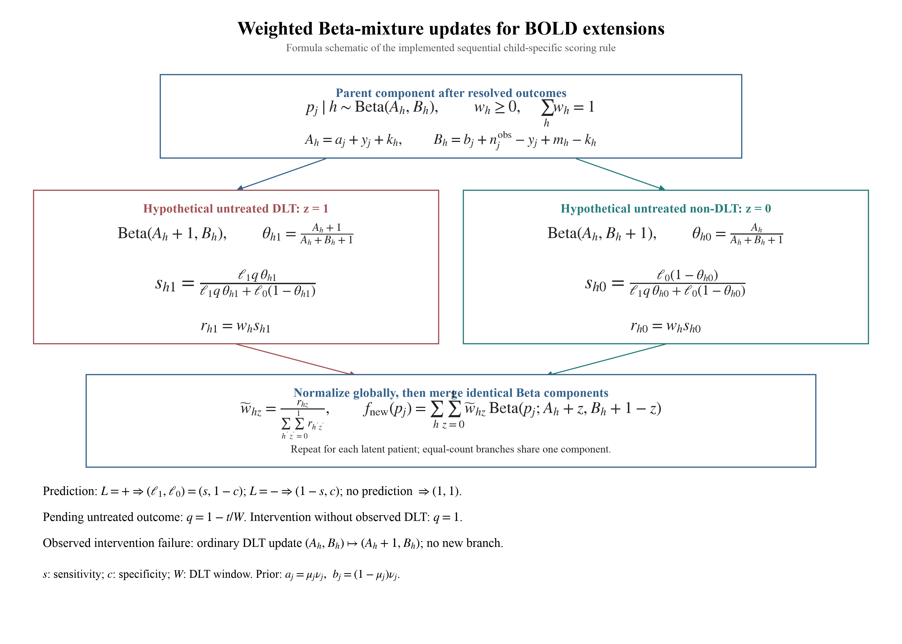

# BOLDx

### Prediction-assisted intervention and time-to-event extensions of BOLD

**An R package for simulation-based phase I dose-finding research.**

BOLDx supports three extensions of the Bayesian Ordered Lattice Design:
**prediction-guided preventive intervention**, **delayed toxicity outcomes
(TITE-BOLD)**, and **their combination**. Original BOLD, BOIN, and TITE-BOIN
implementations are included for matched comparisons.

[Installation](#installation) | [Quick start](#quick-start) |
[Inputs](#design-and-prediction-inputs) | [Methods](docs/methods.md) |
[Reference manual](docs/BOLDx-reference-manual.pdf) |
[Research background](docs/research-background.md) |
[Related Shiny app](https://wguo3.shinyapps.io/bold_boin_phase1_app/)



## Background

In phase I oncology trials, preventing severe toxicity and accommodating delayed
outcomes may improve patient safety and dose finding. BOLDx extends BOLD to
prediction-guided intervention, delayed outcomes, or both, representing
unobserved untreated toxicity with weighted Beta components. Prediction
sensitivity/specificity and intervention effectiveness are separate inputs:
an intervention can fail even after a correct positive prediction.

The accompanying study examined four doses, a target DLT probability of 0.25,
patient caps of 21 and 30, upper toxicity gaps of 0.15 and 0.20, and prediction
sensitivity/specificity of 0.70/0.90 and 0.90/0.98. Its imperfect-intervention
scenario used 80% effectiveness. The supplied research summary reports lower
actual DLT burden with prediction-assisted intervention and shorter trial
duration with delayed-outcome BOLD relative to complete-follow-up BOLD.
The [full supplied background and numerical results](docs/research-background.md)
are retained separately from the package's reproducible examples.

> **Research release.** The engine reproduces the October 31 child-specific
> plug-in mixture rule; this is not exact Bayesian marginal-evidence weighting.
> See [the implementation contract](docs/methods.md). Not intended for live
> clinical dose assignment. The package is not currently published on CRAN.

## Installation

R >= 4.1 and a C++11 compiler are required. Install Rtools on Windows or Xcode
Command Line Tools on macOS if a compiler is not already available.

```r
install.packages("remotes")
remotes::install_github("wguo3773/BOLDx", build_vignettes = FALSE)
library(BOLDx)
```

Alternatively, download the [R source tarball](docs/BOLDx_0.1.0.tar.gz) and run:

```r
install.packages("Rcpp")
install.packages("BOLDx_0.1.0.tar.gz", repos = NULL, type = "source")
```

## Quick start

```r
library(BOLDx)

cfg <- bold_config(
  target = 0.25, nmax = 21, tau = 0.50,
  overdose_cutoff = 0.90, early_n = 12,
  sensitivity = 0.90, specificity = 0.98,
  eligibility = 1.00, rho = 0.80,
  window = 3, accrual_rate = 2
)

result <- simulate_bold(
  truth = c(0.10, 0.25, 0.45, 0.60),
  method = c("prediction", "tite", "combined", "bold", "boin", "tite_boin"),
  config = cfg, nsim = 100, seed = 20261031,
  mtd = 2
)

result$summary  # operating characteristics and Monte Carlo SEs
result$trials   # replicate-level outcomes and dose-specific patient/DLT counts
write.csv(result$summary, "BOLDx-summary.csv", row.names = FALSE)
```

`nsim = 100` is a runnable example, not a recommendation for precise design
comparison. Increase it to reduce Monte Carlo error. The caller's RNG state is
restored after simulation. Methods use the same starting seed within a scenario;
they need not consume identical random draws after protocol differences arise.

### Three extension modes

| `method` | Prediction/intervention | Delayed-outcome decisions |
|:--|:--:|:--:|
| `"prediction"` | Yes | No; complete follow-up |
| `"tite"` | No | Yes |
| `"combined"` | Yes | Yes, with intervention-resolution guard |
| `"bold"` | No | No; Original BOLD comparator |
| `"boin"` | No | No; BOIN comparator |
| `"tite_boin"` | No | Yes; TITE-BOIN comparator |

### Requested outputs

| Summary column | Definition |
|:--|:--|
| `accuracy_pct` | Trials selecting the true MTD (%) |
| `mean_n` | Mean enrolled sample size |
| `actual_dlts` | Mean observed, post-intervention DLTs per trial |
| `above_mtd_pct` | Patients treated above the true MTD / all enrolled patients (%) |
| `duration_months` | Mean trial duration, for TITE and combined modes and TITE-BOIN |

Each outcome has an accompanying Monte Carlo SE. Complete-follow-up summary
duration is `NA`, not zero; its calendar duration is available in
`result$trials$duration` for optional comparisons. Raw output also includes
prevented DLTs, intervention failures, latent DLTs, eligibility, interventions,
and allocation counts. `mtd = 0` includes all-too-toxic scenarios; `mtd = K+1`
represents all doses below target. These evaluation labels never enter decisions.

## Design and prediction inputs

```r
cfg <- bold_config(
  target = .25, nmax = 30, tau = .45,
  overdose_cutoff = .90, early_n = Inf,
  sensitivity = .70, specificity = .90,
  eligibility = 1, rho = .80,
  prior_mean = c(.15, .20, .25, .35),
  prior_pess = c(3, 3, 3, 3),
  start_dose = 1, window = 3, accrual_rate = 2,
  arrival = "uniform", timing = "weibull",
  pending_limit = .50, min_two = FALSE
)
```

- `truth`: 2-10 ordered untreated dose-risk probabilities; not prior means.
- `eligibility`: fraction eligible for prediction (e.g., nonmissing predictors).
- `rho`: intervention success probability; `.80` means 20% failure, `1` means
  perfect effectiveness. It is not sensitivity or specificity.
- Prior at dose j: `Beta(prior_mean[j] * prior_pess[j],
  (1 - prior_mean[j]) * prior_pess[j])`. Scalars apply to every dose.
- `tau`: BOLD's decision-tail target, separate from the DLT target.
- Cohorts contain three patients; `nmax` must be a multiple of three.
- `arrival`: `"uniform"` or `"exponential"`; `timing`: `"weibull"`, `"uniform"`,
  or the `"late"` stress test. Follow-up uses a uniform working timing model.

An observed intervention failure is a regular DLT update, not an additional
branch. Only intervention patients without observed DLT branch over their
unknown untreated status. Combined mode waits for intervened patients to resolve
before the next dose decision. False-positive interventions have no simulated
toxicity harm or other cost in this release.

### Multiple scenarios

```r
scenarios <- rbind(
  c(.10, .25, .45, .60),
  c(.05, .10, .25, .45),
  c(.40, .50, .60, .70)
)
panel <- simulate_scenarios(
  scenarios, mtd = c(2, 3, 0), config = cfg,
  method = c("prediction", "bold", "boin"), nsim = 100, seed = 1
)
panel$summary
```

Scenario results remain separate, including all-too-toxic cases. Choose and
report a scenario/category weighting scheme before computing aggregate effects.

### Inspect the mixture

```r
beta_mixture(
  a = .75, b = 2.25,
  q = c(1, .5), labels = c(1L, -1L),
  sensitivity = .90, specificity = .98, target = .25
)
```

For the formula-only schematic, download [PDF](docs/beta-mixture-formulas.pdf)
or [SVG](docs/beta-mixture-formulas.svg). Its formulas match the implemented
child-specific scoring rule, including global normalization and merged branches.

## Documentation and reproducibility

- [R reference manual (PDF)](docs/BOLDx-reference-manual.pdf), generated from
  the included `man/*.Rd` help pages. This is not evidence of CRAN acceptance.
- [Methods, assumptions, outcome definitions, and provenance](docs/methods.md).
- [Full research background supplied for this release](docs/research-background.md).
- [Runnable quick-start script](inst/examples/quick-start.R).
- Tests cover all modes, accounting identities, random-state restoration,
  limiting cases, scenario boundary labels, priors, and input validation.
- [Regression check](docs/regression-results.txt): 100 seeded trials in each
  of the six modes exactly match the October 31 engine at the default settings.
- [Example summary CSV](docs/example-summary.csv) contains actual package
  output for the quick-start scenario, not the study's aggregate results.

```r
install.packages(c("roxygen2", "testthat", "devtools"))
devtools::test()
```

From the repository parent directory:

```sh
R CMD build BOLDx
R CMD check --no-manual BOLDx_0.1.0.tar.gz
```

The standard Rd sources can also generate a conventional R PDF manual with
`R CMD Rd2pdf BOLDx` when a LaTeX installation is available. The included manual
uses a portable PDF renderer; `tools/build-docs.R` and `tools/make-docs.py`
reproduce it and the schematic.

## Citation and acknowledgments

Wang G-M and Tatsuoka C (2026). *Bayesian Ordered Lattice Design for Phase I
Clinical Trials*. Statistics in Medicine. [doi:10.1002/sim.70456](https://doi.org/10.1002/sim.70456).

This package extends the research simulation engine maintained by Wanru Guo.
Please also cite the BOLDx software version used. Publication details for the
prediction/TITE extension manuscript will be added when available.

## License

GPL (>= 3). Research software provided without warranty.
