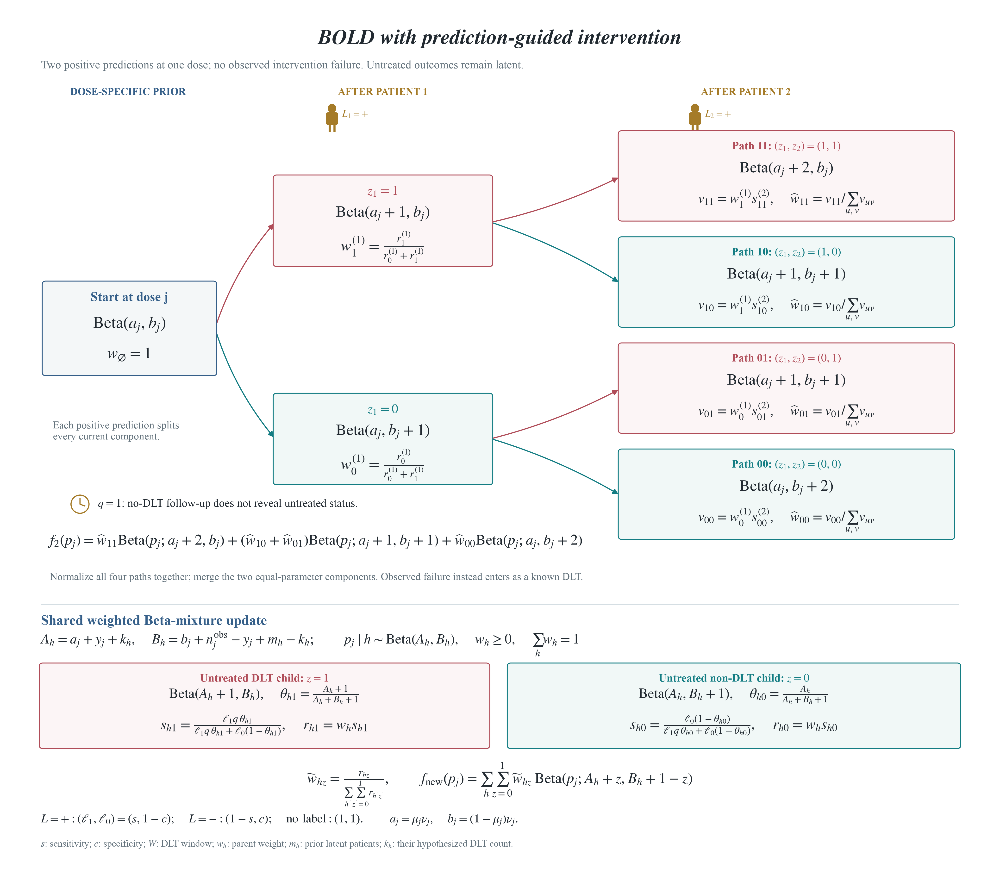
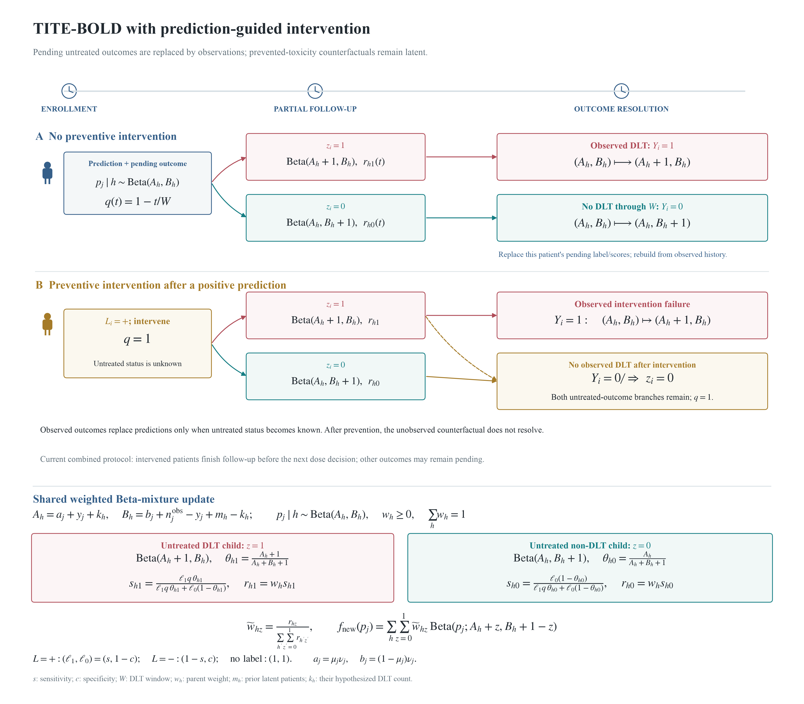

# BOLDx

### Dose recommendations, intervention planning, and trial simulation in R

BOLDx extends the Bayesian Ordered Lattice Design to prediction-guided
preventive intervention, delayed outcomes (TITE), and their combination.
The package has **two separate parts**:

| Part | You supply | You receive | Main function |
|---|---|---|---|
| **1. Dose and intervention recommendations** | Observed patient histories; external predictions when applicable | Next dose/action and proposed intervention flags | `plan_bold()` |
| **2. Simulation** | Assumed true DLT risks, or settings for random risk curves | Accuracy, mean N, actual DLTs, above-MTD allocation, trial duration | `simulate_bold()` or `simulate_random_scenarios()` |

**True DLT risks are simulation inputs only, never inputs for patient-history
recommendations.** Predictions come from an external classifier; BOLDx does not
train that classifier.

[Install](#installation) | [Part 1](#part-1-dose-and-intervention-recommendations) |
[Part 2](#part-2-simulation) | [Settings](#design-settings-and-defaults) |
[Manual](docs/BOLDx-reference-manual.pdf) | [Methods](docs/methods.md)

## Installation

R >= 4.1 and a C++11 compiler are required (Rtools on Windows; Xcode Command
Line Tools on macOS).

```r
install.packages("remotes")
remotes::install_github("wguo3773/BOLDx", build_vignettes=FALSE)
library(BOLDx)
```

Or install the [source package](docs/BOLDx_0.4.0.tar.gz):

```r
install.packages("Rcpp")
install.packages("BOLDx_0.4.0.tar.gz", repos=NULL, type="source")
```

## Choose a Method

| `method` | Design | Recommends doses | Preventive intervention | Partial follow-up |
|---|---|---|---|---|
| `"bold"` | Original BOLD | Yes | No | No |
| `"prediction"` | BOLD-prediction | Yes | Eligible positive predictions | No |
| `"tite"` | TITE-BOLD | Yes | No | Yes |
| `"combined"` | TITE-BOLD-prediction | Yes | Eligible positive predictions | Yes, with intervention-resolution guard |

`"boin"` and `"tite_boin"` comparators are also supported by the simulation
functions and `recommend_dose()`. `plan_bold()` supports the four BOLD designs.

## Part 1: Dose and Intervention Recommendations

### 1.1 Inputs

Evaluate between cohorts of **three patients**. Supply one row per enrolled
patient, in enrollment order:

| Input | Meaning |
|---|---|
| `history$dose` | Actual administered dose index, starting at 1 |
| `history$dlt` | `1`: observed DLT; `0`: none observed to date; `NA`: unknown while pending |
| `history$followup` | Elapsed months; `dlt=0` is not complete without a full assessment window |
| `history$prediction` | Optional recorded external prediction: `1`, `0`, or `NA` |
| `history$eligible` | Optional logical eligibility; defaults to prediction availability |
| `history$intervened` | Optional logical record of intervention actually performed; defaults to `FALSE` |
| `ndoses` | Number of ordered dose levels, 2-10 |
| `current_dose` | Dose of the most recently enrolled cohort, not the next dose |
| `config` | Design settings from `bold_config()` |
| `excluded` | Previously eliminated dose indices; preserve these between calls |
| `prediction`, `eligible` in `plan_bold()` | Predictions and eligibility for the **incoming** three patients |

### 1.2 Example: Dose and Intervention Together

```r
cfg <- bold_config(target=.25, nmax=21, gamma=.90, tau=.50)
h <- data.frame(dose=c(1,1,1), dlt=c(0,0,0), followup=c(3,3,3))
p <- plan_bold(
  history=h, ndoses=4, current_dose=1,
  method="prediction", config=cfg,
  prediction=c(1L,0L,0L), eligible=TRUE
)
p$dose_recommendation
# Method: prediction | Action: escalate | Next dose: 2
# Next cohort: dose 2 (escalate).

p$intervention_plan[,c("dose","intervene","status")]
#   dose intervene   status
# 1    2      TRUE positive
# 2    2     FALSE negative
# 3    2     FALSE negative
p$ready
# TRUE
```

Use any of the four method names above with the same interface. Original BOLD
and TITE-BOLD plan no preventive intervention. Prediction-assisted designs
flag eligible positive predictions. If predictions depend on dose, obtain
them at the candidate dose before acting.

### 1.3 Outputs and Updates

| Output | Meaning |
|---|---|
| `p$dose_recommendation$action` | `start`, `escalate`, `stay`, `deescalate`, `wait`, or `stop` |
| `p$dose_recommendation$next_dose` | Next cohort dose; `NA` for wait/stop |
| `p$dose_recommendation$reason` | Explanation of the decision |
| `p$dose_recommendation$dose_summary` | Counts and, when evaluated, estimated untreated risk and overdose probability |
| `p$dose_recommendation$excluded_doses` | Irreversibly eliminated doses |
| `p$intervention_plan` | Incoming-patient dose and proposed intervention flags |
| `p$ready` | TRUE only when a dose is assigned and required prediction decisions are available |

Waiting or stopping **never schedules intervention**. Missing required incoming
predictions give `ready=FALSE`. Add actual next-cohort records to `history`,
then call again with `excluded=p$dose_recommendation$excluded_doses`.
Proposed flags are not automatically recorded as actual interventions.
These functions allocate the next cohort; they do not declare a final MTD.

### 1.4 Example: Delayed Outcomes

```r
ht <- h
ht$followup <- c(3,3,1)
recommend_dose(ht, 4, 1, method="tite", config=cfg)
# Method: tite | Action: escalate | Next dose: 2

hc <- transform(h, prediction=c(0L,1L,0L), eligible=TRUE,
                intervened=c(FALSE,TRUE,FALSE))
hc$followup <- c(3,1,1)
recommend_dose(hc, 4, 1, method="combined", config=cfg)
# Method: combined | Action: wait
# Combined protocol: await intervention-patient outcome resolution.
```

An observed intervention failure is an ordinary `dlt=1`. Without intervention,
observed outcomes replace pending predictions. After intervention, no observed
DLT does **not** reveal the untreated outcome: latent branches remain even
after full follow-up. Combined mode waits for intervention-patient resolution.
These examples are history-specific, not universal escalation rules.
Protocol-specific statistical review and validation are required before clinical use.

## Part 2: Simulation

Choose **A: one specified scenario**, **B: random scenarios from gaps**, or
**C: your own scenario matrix**. The default is **1,000 trials per scenario
per method**. Change patient caps, predictor performance and effectiveness
through `config`; change trial replicates through `nsim`.

### 2A. One Specified Scenario: `p.true`

`p.true` is a numeric **vector** of assumed untreated DLT probabilities, one
per dose. It is specified by you, not randomly generated. `truth` is an alias.

```r
methods <- c("bold","prediction","tite","combined")
single <- simulate_bold(
  p.true=c(0.05,0.15,0.30,0.45,0.60),
  method=methods, config=bold_config(target=.30),
  nsim=1000, seed=42, mtd=3
)
single$summary  # point estimates for this scenario
single$mcse     # Monte Carlo SE across its 1,000 trials
single$trials   # individual simulated trial records
```

**Actual output: estimate (Monte Carlo SE), rounded.** Target .30, cap 21,
gamma .90, tau .50, sensitivity/specificity .90/.98, rho .80, seed 42.

| Method | Accuracy (%) | Mean N | Actual DLTs/trial | Above MTD (%) | Duration (months) |
|---|---:|---:|---:|---:|---:|
| Original BOLD | 51.20 (1.58) | 20.60 (0.04) | 6.00 (0.05) | 31.58 (0.70) | - |
| BOLD-prediction | 48.50 (1.58) | 20.62 (0.04) | 1.75 (0.04) | 32.67 (0.71) | - |
| TITE-BOLD | 47.30 (1.58) | 20.49 (0.04) | 5.16 (0.04) | 20.87 (0.63) | 19.12 (0.07) |
| Combined | 49.10 (1.58) | 20.56 (0.04) | 1.70 (0.04) | 30.77 (0.72) | 23.25 (0.08) |

[Point estimates CSV](docs/single-1000-summary.csv) |
[Monte Carlo SE CSV](docs/single-1000-mcse.csv).
These are example results, not universal comparative performance claims.

### 2B. Random Scenarios from Gaps: 50 x 1,000

```r
panel <- simulate_random_scenarios(
  ndoses=4, mtd=2, lower_gap=.10, upper_gap=.15,
  risk_bounds=c(.01,.70), nscenarios=50,
  method=methods, config=bold_config(target=.25),
  nsim=1000, seed=42
)
panel$scenarios  # 50 generated risk vectors
panel$settings  # scenario, MTD category and gap labels
panel$summary   # results for each scenario and method
panel$mcse      # Monte Carlo SE WITHIN each scenario
panel$aggregate # mean and SD ACROSS scenario-level estimates
panel$trials    # all individual simulated trials
```

**Generation rule:** for interior MTD `j`, fix `p[j]=target`,
`p[j-1]=target-lower_gap` and `p[j+1]=target+upper_gap`. Remaining lower and
upper risks are sorted uniform draws inside their respective bounds. Here,
each curve is `(0.15, 0.25, 0.40, random value between 0.40 and 0.70)`.
This explicit uniform-tail generator does not uniformly sample all possible
curves or recreate previously saved manuscript scenarios.

**Actual output: mean (between-scenario SD), rounded.** Target .25, MTD 2,
cap 21, other settings as above; 50 scenarios x 1,000 trials per method.

| Method | Accuracy (%) | Mean N | Actual DLTs/trial | Above MTD (%) | Duration (months) |
|---|---:|---:|---:|---:|---:|
| Original BOLD | 50.02 (1.61) | 19.43 (0.11) | 5.24 (0.08) | 28.77 (0.78) | - |
| BOLD-prediction | 46.89 (1.85) | 19.36 (0.10) | 1.62 (0.05) | 38.22 (0.91) | - |
| TITE-BOLD | 46.11 (1.55) | 18.36 (0.12) | 4.78 (0.08) | 25.93 (0.81) | 16.34 (0.12) |
| Combined | 46.77 (1.75) | 19.19 (0.10) | 1.53 (0.04) | 33.87 (0.86) | 20.79 (0.12) |

[Generated curves](docs/random-50x1000-scenarios.csv) |
[Per-scenario estimates](docs/random-50x1000-estimates.csv) |
[Within-scenario SE](docs/random-50x1000-mcse.csv) |
[Mean/SD summary](docs/random-50x1000-mean-sd.csv).

### 2B.1 Multiple Categories and Gaps

```r
panel <- simulate_random_scenarios(
  ndoses=4, mtd=0:4, lower_gap=.10, upper_gap=c(.15,.20),
  nscenarios=50, nsim=1000, method=methods,
  config=bold_config(target=.25, nmax=30, gamma=.90, tau=.45), seed=42
)
panel$aggregate
```

This runs **50 scenarios for EACH category/gap combination**, not 50 total:
5 categories x 2 gaps x 50 scenarios x 1,000 trials = **500,000 trials per
method**. Summaries keep categories and gaps separate. `mtd=0` means all too
toxic; `mtd=ndoses+1` means all below target. Their first risk is
`target+upper_gap` or last risk is `target-lower_gap`, respectively.
A boundary gap without an adjacent dose has no effect. Some settings have no
free doses and yield identical curves; inspect `panel$scenarios`.
`generate_scenarios()` generates curves for one scalar category/gap setting
without simulating trials.

### 2C. Your Own Scenario Matrix

```r
curves <- rbind(c(.10,.25,.45,.60), c(.05,.10,.25,.45), c(.40,.50,.60,.70))
panel <- simulate_scenarios(
  scenarios=curves, mtd=c(2,3,0), method=methods,
  config=bold_config(target=.25), nsim=1000, seed=42
)
panel$summary
panel$aggregate
```

Each matrix row is one curve. Supply explicit MTD labels for all-too-toxic
(`0`) and all-below-target (`K+1`) cases. Otherwise, omitted `mtd` selects
the dose closest to target, with ties going to the lower dose. MTD labels
are used for evaluation only, never in dose decisions.

### 2.3 Outcomes and Uncertainty

| Metric | Definition |
|---|---|
| `accuracy_pct` | Trials selecting the specified true MTD (%) |
| `mean_n` | Mean enrolled patients per trial |
| `actual_dlts` | Mean actual observed DLTs per trial, after intervention |
| `above_mtd_pct` | Total patients above true MTD / total enrolled patients x 100 |
| `duration_months` | Mean calendar duration for TITE, combined and TITE-BOIN |

| Output | What varies? | Interpretation |
|---|---|---|
| `single$mcse`, `panel$mcse` | 1,000 trials at one fixed risk curve | **SE:** Monte Carlo precision of each scenario-level estimate |
| `panel$aggregate` | 50 scenario-level estimates in one category/gap group | **SD:** between-scenario dispersion, including finite-trial noise |
| `single$trials`, `panel$trials` | Individual simulated trials | Raw outcomes for custom summaries |

For mean N, actual DLTs and duration, Monte Carlo SE = trial-level SD /
sqrt(nsim). Accuracy SE = 100 x SD(correct-selection indicator) / sqrt(nsim).
Above-MTD SE uses patient-weighted ratio influence values. **SE and SD are
not interchangeable.** To obtain trial-level SD rather than SE:

```r
sd(subset(single$trials, method=="tite")$dlt)
```

Aggregate means weight scenarios equally and group by method and MTD, plus
gaps for generated panels. One-scenario groups have undefined SD (`NA`).
Complete-follow-up duration is omitted from summary (`NA`, not zero);
its simulated duration remains in `trials$duration` for optional comparisons.

## Design Settings and Defaults

```r
cfg <- bold_config(
  target=.25, nmax=21, gamma=.90, tau=.50,
  sensitivity=.90, specificity=.98, eligibility=1, rho=.80,
  window=3, accrual_rate=2, prior_mean=NULL, prior_pess=3,
  start_dose=1, early_n=12, pending_limit=.50, min_two=FALSE,
  arrival="uniform", timing="weibull"
)
```

| Setting | Default | Meaning |
|---|---|---|
| `target` | .25 | Target untreated DLT probability |
| `gamma` | .90 | Posterior overdose-elimination cutoff; alias `overdose_cutoff` |
| `tau` | .50 | BOLD allocation-tail target, not the target DLT probability |
| `nmax` | 21 | Patient cap, multiple of three |
| `sensitivity`, `specificity` | .90, .98 | Classifier performance for untreated DLT status |
| `eligibility` | 1 | Simulation probability of prediction eligibility |
| `rho` | .80 | Simulation prevention success probability conditional on otherwise-occurring DLT |
| `window`, `accrual_rate` | 3, 2 | Assessment months; mean arrivals per month |
| `prior_mean`, `prior_pess` | target, 3 | Scalar or dose-specific prior mean and effective size |
| `start_dose`, `early_n` | 1, 12 | Starting dose; unchanged-dose early-stopping count (`Inf` disables) |
| `pending_limit`, `min_two` | .50, FALSE | Pending-fraction and escalation-readiness controls |
| `arrival`, `timing` | uniform, Weibull | Generative arrival and DLT timing models |

**Gamma and tau are adjustable in both parts**, e.g.
`bold_config(gamma=.95, tau=.45)`. Gamma is stored as `config$overdose_cutoff`;
if both aliases are supplied they must agree. Historical recommendations use
actual records, not generated eligibility, rho or timing. Dose j's prior is
`Beta(prior_mean[j]*prior_pess[j], (1-prior_mean[j])*prior_pess[j])`.

## Function Index

| Function | Purpose |
|---|---|
| `bold_config()` | Validate shared design settings |
| `plan_bold()` | Recommend dose and plan incoming interventions together |
| `recommend_dose()` | Recommend next dose only, including BOIN comparators |
| `plan_intervention()` | Flag interventions from predictions only |
| `simulate_bold()` | Simulate one specified curve (`p.true` or `truth`) |
| `generate_scenarios()` | Generate curves for one MTD/gap setting |
| `simulate_random_scenarios()` | Generate and simulate MTD/gap panels |
| `simulate_scenarios()` | Simulate a supplied matrix of curves |
| `summarise_scenarios()` | Summarize scenario-level mean/SD by group |
| `beta_mixture()` | Inspect the implemented Beta-mixture update |

## Formulas and Branching Schematics





[Prediction PDF](docs/prediction-branching-schematic.pdf) |
[TITE-prediction PDF](docs/tite-prediction-branching-schematic.pdf) |
[Mixture formulas](docs/beta-mixture-formulas.pdf).

## Documentation and Reproducibility

Prediction performance and intervention success are separate inputs. An
intervention can fail after a correct positive prediction. The working
follow-up model is uniform even with simulated Weibull DLT times.
False-positive interventions have no simulated toxicity harm or cost.

- [R reference manual](docs/BOLDx-reference-manual.pdf), generated from help pages.
- [Methods, assumptions and provenance](docs/methods.md).
- [Full supplied study background](docs/research-background.md), separate from these examples.
- [Runnable two-part workflow](inst/examples/two-part-workflow.R).
- [Reproduce the displayed output](tools/make-workflow-examples.R).
- [Related Shiny app](https://wguo3.shinyapps.io/bold_boin_phase1_app/).
- [Original-engine regression](docs/regression-results.csv).

```r
?BOLDx_workflows
?plan_bold
?simulate_bold
?simulate_random_scenarios
```

Wang G-M and Tatsuoka C (2026). *Bayesian Ordered Lattice Design for Phase I
Clinical Trials*. Statistics in Medicine. [doi:10.1002/sim.70456](https://doi.org/10.1002/sim.70456).
Maintainer: Wanru Guo, wanru.guo@som.umaryland.edu. License: GPL (>= 3).
